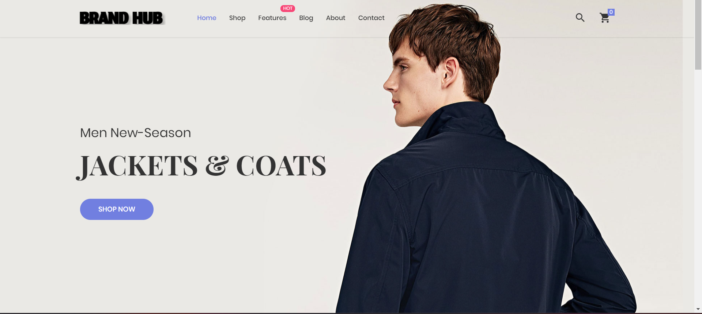
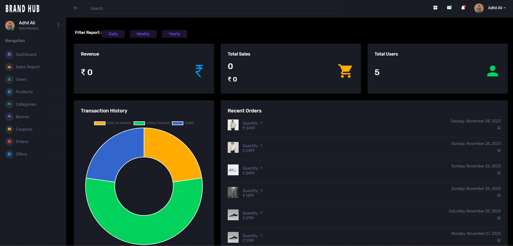

# Brand Hub E-commerce Website

## Description
This is a Node.js Express project for an e-commerce website specializing in the sale of men Fashion. The project includes both an admin panel and a user panel, allowing administrators to manage products, orders, and users, while users can browse products, make purchases, and manage their accounts.

## LiveLink User: https://ecommerce-brand-hub-master-adhil.onrender.com/

## Credentials
### User
- Email: user@gmail.com
- Password: 12345@

## LiveLink Admin: https://ecommerce-brand-hub-master-adhil.onrender.com/admin
## Credentials
### Admin
- Email: admin@gmail.com
- Password: 123456

## Screenshots

🛍️ User Experience:

•🛡️ Secure OTP login
•🔍 Shop with Search and Filters
•👤 Personalized Profiles
•🛒 Seamless Cart & Checkout
•💳 Various Payment Methods (Razorpay, Wallet, Cash on Delivery)
•🧾 PDF Invoice Download
•🎫 Coupons
•🔐 Forgot and Change Password
•🔄 Referral Bonus
•🖼️ Image Cropping
•🎁 Product Offer and Category Offer
•🔍 Image Zoom
•💼 Wallet 
•📦Order History & Order Monitoring

🖥️ Admin Panel:

•📊 Intuitive Dashboard
•📈 Sales Analytics with Date Filters
•📥 Excel Sales Report Download
•📦 Efficient Order Management
•🔄 Effortless Product and User Control
•🎟️ Offer Management 
•🎫 Coupon Control
•🚀 Banner Change
  

🎨 FrontEnd:

•🌐 HTML & CSS
•🚀 JavaScript
•🔄 Ajax/Fetch/Axios for Better User Experience
•🌐 EJS for rendering dynamic content
•🌈 Bootstrap for responsive design

🛠️ BackEnd:

•☁️ Node.js for robust backend
•🚀 Express.js for server-side logic
•📊 MongoDB for the database

🏠 Hosting:

•🐳 Docker for scalable deployment
•☁️ AWS EC2 for secure and reliable hosting
•🔄 Nginx for load balancing
•🔥 Firewall for enhanced security
•🔒 HTTPS (SSL/TLS certificates) for secure data transmission

## Installation
1. Clone the repository: `git clone <repository-url>`
2. Navigate to the project directory: `cd <destination>`
3. Install dependencies: `npm install ` / `npm install nodemon -g`
4. Set up your environment variables (e.g., database connection string, session secret)
5. Start the server: `npm start`

## Usage
- Visit the website and explore the available products
- Sign up for a user account or log in if you already have one
- Add products to your cart and proceed to checkout to place an order
- Log in to the admin panel to manage products, orders, and users

## Contributing
Contributions are welcome! If you'd like to contribute to this project, please follow these steps:
1. Fork the repository
2. Create a new branch: `git checkout -b feature-name`
3. Make your changes and commit them: `git commit -am 'Add new feature'`
4. Push to the branch: `git push origin feature-name`
5. Submit a pull request

## License
[MIT License](LICENSE)

## Acknowledgements
- [Express.js](https://expressjs.com/)
- [MongoDB](https://www.mongodb.com/)
- [Bootstrap](https://getbootstrap.com/)
